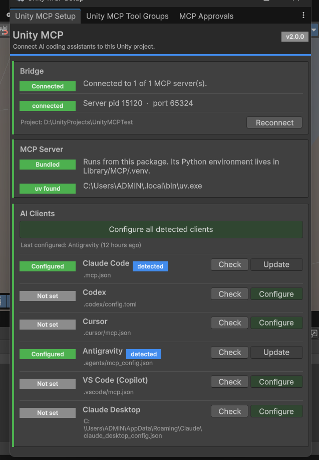
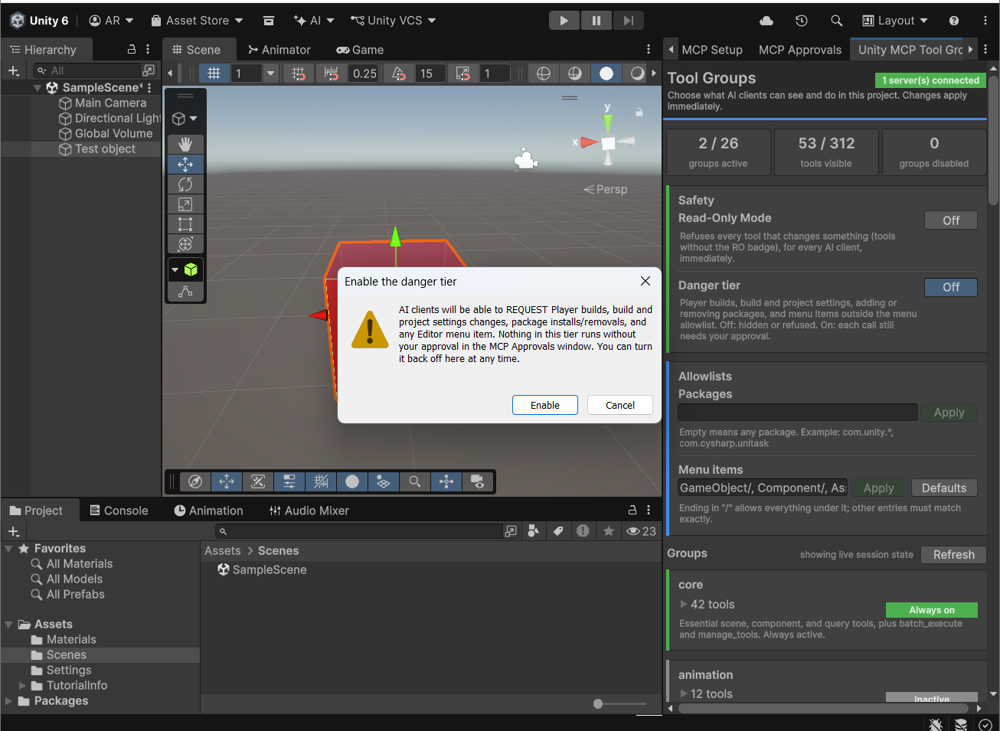
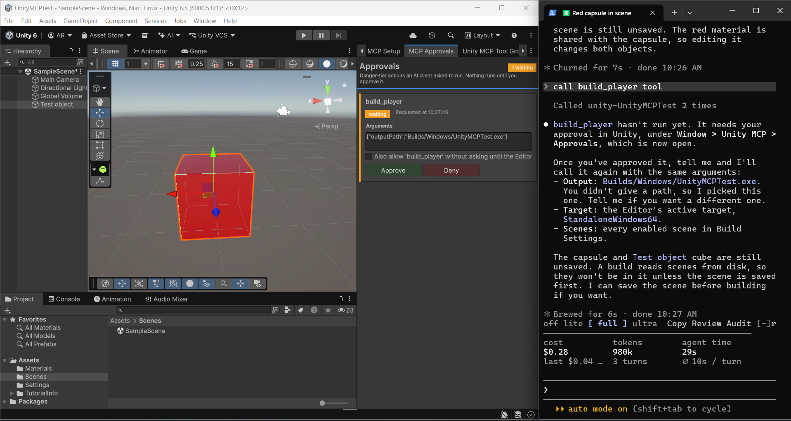
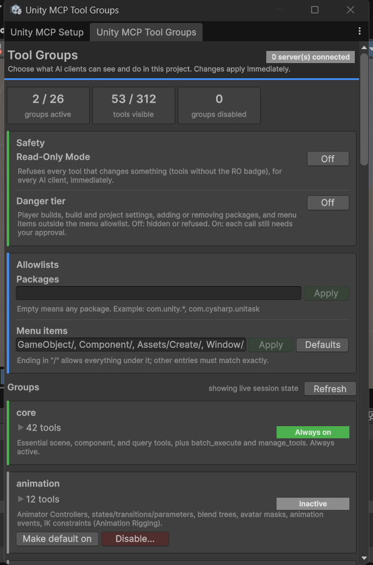
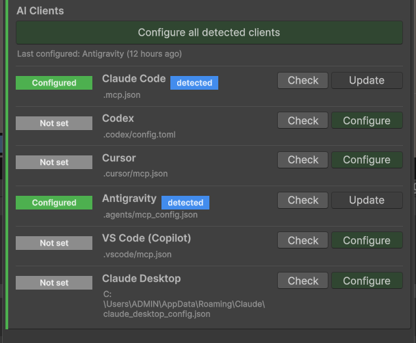
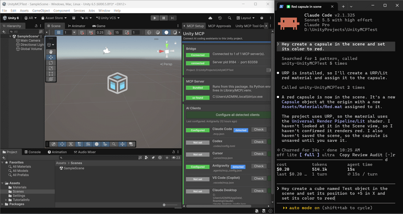
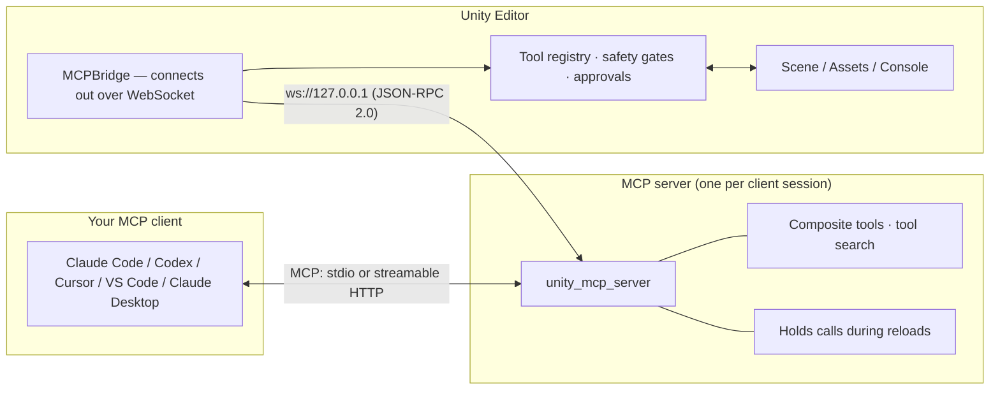

<!-- markdownlint-disable MD033 MD041 -->
<div align="center">

# Unity MCP Bridge

**Give your AI coding assistant real hands inside the Unity Editor.**

[Model Context Protocol](https://modelcontextprotocol.io) server + Editor bridge that lets
Claude Code, Codex, Cursor, VS Code (Copilot), Claude Desktop, Antigravity, or any
MCP-compatible client create GameObjects, write scripts, wire physics, build UI, light scenes,
bake NavMeshes, and orchestrate entire gameplay systems — directly in a running Unity project,
with real safety guardrails.

[](unity/com.unitymcp.bridge/LICENSE.md)
[](unity/com.unitymcp.bridge/CHANGELOG.md)
[](unity/com.unitymcp.bridge/package.json)
[](unity/com.unitymcp.bridge/Server~/unity_mcp_server/http_transport.py)
[](docs/tool-catalog.md)
[](unity/com.unitymcp.bridge/Server~/pyproject.toml)

[Highlights](#highlights) · [Quick start](#quick-start) · [Security](#-security) · [Tool groups](#-tool-groups) · [Token optimization](#-token-optimization) · [Tool catalog](#tool-catalog) · [Architecture](#architecture)

</div>

<p align="center">
  
  <br>
  <sub>The in-Editor Setup window — live bridge status, the bundled server, and six clients configured in one click.</sub>
</p>

---

## Why Unity MCP Bridge

Most "AI + Unity" integrations stop at generating a C# snippet you paste in yourself. This
one closes the loop: your assistant calls real Editor APIs, sees the real result (hierarchy,
console, compile status), and iterates — the same way a human developer works inside the
Editor, just driven by natural language.

- **312 tools across 26 groups** — from atomic primitives (`create_gameobject`, `add_component`)
  to full gameplay systems (FPS controllers, enemy AI, save systems, procedural level layout).
- **Survives recompiles.** Script changes and Play Mode reload Unity's scripting domain; the
  client stays connected, calls made meanwhile wait and complete, and a call interrupted by the
  reload never runs twice.
- **Safety by design** — risky actions are off until you enable them and then need your
  approval in the Editor; every call is audit-logged; file access is sandboxed to `Assets/`.
- **Lean on tokens** — only the `core` tools are loaded at first, everything else is searched
  and pulled in on demand, and big reads (hierarchy, asset lists, console) come back
  summary-first.
- **One-step install** — add the Unity package, click *Configure all detected clients*. The
  MCP server ships inside the package.

## Highlights

The three things that matter most in 2.0, each covered in depth below:

| | What you get | Read more |
|---|---|---|
| 🛡️ **Security** | A **danger tier** (off by default) for builds, project settings, package changes and risky menu items; **human approval** in the Editor for every danger-tier call; sandboxed filesystem; random per-launch auth token; browser-origin blocking; audit log; rate limiting; Read-Only Mode. | [Security](#-security) |
| 🧠 **Tool groups** | 26 groups, only `core` visible at first. Find tools by keyword, call a hidden tool without loading its group, or activate a whole group. A human-only **Tool Groups window** can disable groups outright, set defaults, and flip Read-Only Mode. | [Tool groups](#-tool-groups) |
| 🪙 **Token optimization** | Compact JSON (about half the tokens), summary-first reads with paging, `describe` + `call` proxy for single hidden tools, `batch_execute` for many calls in one round trip, and a `list_changed` signal only when the visible tool list really changes. | [Token optimization](#-token-optimization) |

Also new in 2.0: [domain-reload survival](#-built-for-the-way-unity-actually-works), a
[bundled server launched with `uv`](#-one-step-install-and-six-clients), automatic config
upkeep across package updates, and a [release pipeline](#releases-and-distribution) (PyPI,
`.mcpb`, OpenUPM).

---

## 🛡️ Security

An assistant that can drive your Editor deserves the same care as any other tool with write
access to your project. Unity MCP Bridge layers several independent controls, so no single
bypass opens everything. **Every control below is switched by a human in the Editor, never by
the AI.**

### The danger tier

Some actions can change your build output, your project configuration, or your machine, so
they sit behind a tier that is **off by default**. While it's off:

| Action | Behaviour while the tier is off |
|---|---|
| `build_player`, `configure_build_settings`, `manage_project_settings` | Hidden from the tool list and refused as "unknown tool" |
| `manage_packages` add / remove | Tool stays visible; add/remove are refused with a reason |
| `execute_menu_item` outside the allowlist | Refused with a reason |

Turn the tier on in **Window → Unity MCP → Tool Groups**; Unity asks you to confirm first.
Script tools (`create_script`, `update_script`, …) are *not* in the danger tier, since
writing code is the core job; see the note at the end of this section.

<p align="center">
  
  <br>
  <sub>Read-Only Mode and the danger tier are both off by default. Enabling the tier needs an explicit confirmation.</sub>
</p>

### Human approval, every time

Once the tier is on, each danger-tier call still needs *your* click:

1. The agent calls the tool. It returns `{status: "awaiting_approval"}` and **nothing runs**.
2. The request appears in **Window → Unity MCP → Approvals**, which opens by itself.
3. You click **Approve** (or **Deny**). After Approve, the agent's next call with the *same
   tool and arguments* runs exactly once.
4. **Allow for this session** stops the prompts for that one tool until the Editor closes.

Approvals have no time limit, survive domain reloads, and a denial tells the agent not to
retry.

<p align="center">
  
  <br>
  <sub>The agent asks for <code>build_player</code> and is told to wait. Nothing runs until you click Approve in Unity.</sub>
</p>

### Menu allowlist

`execute_menu_item` is an escape hatch for un-wrapped Unity features, so it only runs
allowlisted paths without approval. Defaults: `GameObject/`, `Component/`,
`Assets/Create/`, `Window/`, `Edit/Play`, `Edit/Pause`, `Edit/Step`, `Edit/Undo`,
`Edit/Redo`, `Edit/Frame Selected`. Edit the list in the Tool Groups window.

### Full control summary

| Control | Detail |
|---|---|
| **Network exposure** | Everything binds `127.0.0.1`. The Unity link refuses any request carrying a browser `Origin` header (blocks DNS-rebinding from web pages). HTTP mode always requires a bearer token and refuses to bind beyond loopback without one you set. |
| **Authentication** | The Editor creates a random token **per launch** (kept across domain reloads, deleted on quit) and publishes it in `Library/MCP/unity.json`, written only by the one Editor holding the project's OS-level instance lock. Every server connection is verified against it. |
| **Protocol check** | Unity package and server check each other's protocol version on connect and refuse a mismatch with a clear message. |
| **Danger tier + approvals** | Builds, build/project settings, package changes and non-allowlisted menu items are off by default; when on, each call needs your approval in the Editor. |
| **Destructive-action gating** | `delete_*`, apply and revert operations require `confirm: true`, enforced centrally so no individual tool can skip it. |
| **Filesystem sandboxing** | All file operations are contained to `Assets/`, with symlink/junction traversal protection verified against real on-disk links. |
| **Audit trail** | Every call is logged to `Library/MCP/audit.log`: each argument value cut at 1 KB, rotated at 10 MB, 3 old files kept. |
| **Rate limiting** | 100 calls per 10 s per connection; batches count per item. |
| **Read-Only Mode** | One toggle in the Tool Groups window: every tool not marked read-only is refused. |
| **Disabled groups** | A disabled group behaves as if it doesn't exist, so the agent can't even learn its tools are there. `core` can never be disabled. |
| **Liveness** | The server pings Unity every 10 s and drops a connection silent for 20 s. |
| **Headless editors** | The bridge does not start under `-batchmode` unless `UNITY_MCP_ALLOW_BATCHMODE=1`. |
| **HTTP transport** | Bearer token always required. Without `UNITY_MCP_HTTP_TOKEN`, one is generated once, saved to `Library/MCP/http_token` and printed on stderr. Requests from a non-localhost browser `Origin` get `403`. |
| **Supply chain** | Server dependencies are pinned exactly (`mcp==1.28.1`, `websockets==17.4`) and installed from the committed `uv.lock`. PyPI publishing uses trusted publishing, with no stored token. |

> **Be aware:** an agent that can write C# scripts can run code in your Editor. That is the
> point of the script tools, so review what it writes, as you would any contributor's code.

Found a security issue? Please open a private report rather than a public issue.

---

## 🧠 Tool groups

312 tool definitions in an assistant's context at once wastes tokens and hurts tool choice.
Tools are therefore organised into **26 groups**, and **only `core` is visible by default**.

### Three ways to use a hidden tool

All through one tool, `manage_tools`:

| You need… | The assistant calls | Context cost |
|---|---|---|
| To find the right tool | `manage_tools(action="search", query="bake navmesh")` | BM25 keyword search over the whole catalog; returns names and one-liners, no schemas |
| **One or two** tools from a hidden group | `manage_tools(action="describe", tools=[...])` then `manage_tools(action="call", tool="…", arguments={…})` | Schema for just those tools (up to 10 per `describe`); the group stays hidden |
| **Many** tools from one group | `manage_tools(action="activate", groups=["lighting"])`, call tools directly, then `deactivate` | Full schemas for the group, loaded only while needed |

`call` runs through exactly the same safety checks as a direct call: the danger tier,
approvals, `confirm`, path guard, rate limiter and audit log all still apply. `reset` returns
the session to its default groups, and `list_groups` shows every group live.

### The groups

| Category | Groups | Highlights |
|---|---|---|
| **Core scene work** | `core`, `scene` | GameObjects, transforms, hierarchy queries, undo/redo, multi-scene management |
| **Rendering & atmosphere** | `lighting`, `cameras`, `rendering`, `vfx` | Lightmapping/GI, Cinemachine, URP post-processing (bloom, vignette, DoF, color grading), particles, decals |
| **World building** | `terrain`, `levelgen`, `navmesh`, `timeline` | Terrain sculpting/painting, procedural room/corridor generation, NavMesh baking & agents, Timeline sequences |
| **Gameplay systems** | `fps_controller`, `weapons`, `enemy_ai`, `gameplay` | First-person rigs, hitscan/projectile weapons, patrol/chase/attack AI, save systems, inventories, doors & keys |
| **Content pipeline** | `scripting`, `assets`, `animation`, `audio`, `ui`, `input` | C# CRUD with compile-status polling, prefabs/materials, Animator/BlendTrees/IK, spatial audio & mixers, UGUI, Input System |
| **Engineering tools** | `physics`, `behavior_tree`, `inspection`, `testing`, `profiling`, `build` | Colliders/joints/raycasts, custom Behavior Trees, screenshots, Play Mode automation, profiler snapshots, Player builds |

### The Tool Groups window

`Window → Unity MCP → Tool Groups` is the human control panel. The AI cannot change anything
in it.

- **Disable a group** so it behaves as if it doesn't exist: hidden, refused by name, and
  refused at call time with the same "unknown tool" error. Takes effect in live sessions
  within about a second.
- **Default-active groups** that new sessions start with (changing them doesn't yank tools
  out from under a conversation already in progress).
- **Read-Only Mode** — allow only tools marked read-only.
- **Danger tier switch**, the **menu allowlist** and an optional **package allowlist** that
  limits which packages `manage_packages` may add (empty = unrestricted; entries are exact IDs
  or `prefix.*`). See [Security](#-security).
- **Connected servers**, one per running AI client session.

<p align="center">
  
  <br>
  <sub>Live counts (2 / 26 groups active, 53 / 312 tools visible), safety switches, allowlists, and per-group <b>Make default on</b> / <b>Disable…</b>.</sub>
</p>

Tool annotations (`readOnlyHint`, `destructiveHint`) are published for every tool, so clients
that honor them can prompt appropriately on their own side too.

---

## 🪙 Token optimization

Every token an assistant spends reading tool schemas or oversized results is a token it isn't
spending on your task. 2.0 trims both sides.

### Smaller, quieter results

- **Compact JSON.** No indentation, no `\u` escapes: **roughly half the tokens** for the same
  data compared with pretty-printed output.
- **Summary-first big reads.** Large results come back as an overview plus one page, and the
  assistant drills down only where it needs to:

| Tool | Default result | Drill down with |
|---|---|---|
| `get_hierarchy` | Top level, each node with `childCount` (up to 200 nodes) | `path`, `depth` (`-1` = all), `limit` (`0` = no cap). `depth=-1, limit=0` is the old full tree, still cached. |
| `list_assets`, `list_scripts`, `find_gameobjects` | Everything when small; over 100 results: `total`, a `byFolder` count and the first page | `offset` / `limit` (`limit=0` = all) |
| `read_console_log` | Per-severity `counts` plus the newest 20 entries, no stack traces | `includeStackTraces=true` |
| `get_console_logs` | 20 entries, no stack traces | `count`, `includeStackTraces=true` |

### Fewer tool schemas in context

- Only `core` is loaded up front; the rest is found with `search` and pulled in with
  `describe` + `call` or `activate` (see [Tool groups](#-tool-groups)).
- `tools/list_changed` is sent **only** when the visible list really changes (activate,
  deactivate, reset), not on every call.
- Tool descriptions are held to a size budget (enforced by `test_tool_description_budget`).

### Fewer round trips

- **`batch_execute`** runs up to 25 quick calls in one request. Slow tools (script
  create/update/delete, anything that recompiles) can't be batched.
- **A bundled agent guide** is installed on Configure so the assistant knows all of this
  from the first prompt: a `unity-mcp` skill for Claude Code, or a marked section in
  `AGENTS.md` for Codex, Cursor, Antigravity and VS Code.

---

## Features

### 🔁 Built for the way Unity actually works

Every script edit recompiles and reloads Unity, which drops naive bridges. Here the MCP server
is the long-lived side and the Editor reconnects to it after each reload:

- Calls made during a reload are held (up to 60 s, `UNITY_MCP_RELOAD_TIMEOUT`) and then answered.
  Past the limit they fail with "Unity is reloading … retry shortly".
- A call cut off by the reload is re-sent with the same id, and Unity returns its stored answer
  (200 entries, 5 minutes, kept across the reload) instead of running it again.
- The client's tool list never shrinks while Unity is away.
- Several AI clients can work on one project at once; the Editor connects to each of them.
- Unity reconnects on a bounded schedule (0 / 1 / 3 / 5 / 10 / 30 s); after that, the Setup
  window's **Reconnect** button picks it up again.

### ⚙️ One-step install and six clients

`Window → Unity MCP → Setup` → **Configure all detected clients** writes each client's config
file directly: no CLI, no repo to clone, no virtualenv to create, no Python path to set.

| Client | Config written | Agent guide |
|---|---|---|
| **Claude Code** | `.mcp.json` | `.claude/skills/unity-mcp` skill |
| **Codex** | `.codex/config.toml` | marked section in `AGENTS.md` |
| **Cursor** | `.cursor/mcp.json` | marked section in `AGENTS.md` |
| **Antigravity** | `.agents/mcp_config.json` | marked section in `AGENTS.md` |
| **VS Code (Copilot)** | `.vscode/mcp.json` | marked section in `AGENTS.md` |
| **Claude Desktop** | global config (or the `.mcpb` bundle) | — |

- The server ships **inside the package** (`Server~/`) and runs through [uv](https://docs.astral.sh/uv/).
  Each project gets its own environment in `Library/MCP/.venv`, built from the exact versions in
  `uv.lock`. If uv is missing, the Setup window shows the one-line install command with a Copy
  button.
- **Configs stay valid across updates.** On Editor start, any config holding this project's
  `unity-<Project>` entry is rewritten if the package folder or uv moved; unchanged files are
  left alone. This also migrates 1.x configs.
- Configuring never touches your other settings. Only our own entry changes, so Claude
  Desktop preferences or VS Code `inputs` are preserved.
- Text outside the `AGENTS.md` markers is never modified.

<p align="center">
  
  <br>
  <sub>Each client shows its status and config path, with <b>Check</b>, <b>Configure</b> or <b>Update</b>.</sub>
</p>

### 🎨 A consistent Editor UI

Setup, Tool Groups, Approvals and Tool Builder share one design: header banner, cards with a
colored status stripe, status pills (Connected, Configured, Disabled, RO …), tinted primary
buttons and a tooltip on every field and button. Setup also lists each connected MCP server
(pid, port, state, last error) with a **Reconnect** button.

### 🔌 Two transports

- **stdio** (default) — what every desktop client uses.
- **Streamable HTTP** (`UNITY_MCP_TRANSPORT=http`) — drive Unity from another machine or share
  one server between clients. Always token-protected; browser requests from other origins are
  refused.

### 🧰 Build your own tools

Add a Unity-side tool with one C# method, or chain existing tools visually. See
[Extending it](#extending-it).

---

## Quick start

Requirements: **Unity 6 (6000.0+)** and **[uv](https://docs.astral.sh/uv/)**. uv runs the
bundled server and downloads a matching Python (3.11+) by itself if you don't have one; the
Setup window shows the one-line install command if uv is missing.

### 1. Add the Unity package

`Window → Package Manager → + → Add package from git URL...`

```
https://github.com/AniketRaut02/unity-mcp.git?path=/unity/com.unitymcp.bridge
```

Append a release tag (for example `#v2.0.0`) to pin a version. Or, once it's listed on OpenUPM:
`openupm add com.darkpixelgd.unitymcpbridge`.

Newtonsoft Json and AI Navigation are pulled in automatically as package dependencies.

### 2. Configure your AI client

`Window → Unity MCP → Setup` → **Configure all detected clients**.

That writes the config for every supported client installed for your user, or click
**Configure** next to one. It also installs the usage guide for the agent (see
[above](#-one-step-install-and-six-clients)).

### 3. Start your client in the project

Restart the client (for Claude Code: run `claude` in the project folder). The Setup window
shows the server as connected within a second or two. Then ask:

> "Create a capsule in the scene and set its color to red."

<p align="center">
  
  <br>
  <sub>Claude Code creates the capsule and a red material in the running Editor, with no copy-pasting and no restart.</sub>
</p>

The first start takes a few seconds while uv installs the server's dependencies into
`Library/MCP/.venv`; after that it's instant.

<details>
<summary><b>Configuring a client by hand</b></summary>

Every client runs the same command. For Claude Code, `.mcp.json` at the project root:

```json
{
  "mcpServers": {
    "unity-<YourProjectName>": {
      "command": "/absolute/path/to/uv",
      "args": ["run", "--project", "<package folder>/Server~", "--frozen",
               "python", "-m", "unity_mcp_server.server"],
      "env": {
        "UNITY_MCP_PROJECT_ROOT": "/absolute/path/to/YourUnityProject",
        "UV_PROJECT_ENVIRONMENT": "/absolute/path/to/YourUnityProject/Library/MCP/.venv",
        "PYTHONPATH": "<package folder>/Server~"
      }
    }
  }
}
```

Codex uses the same command in TOML (`.codex/config.toml`):

```toml
[mcp_servers.unity-<YourProjectName>]
command = "/absolute/path/to/uv"
args = ["run", "--project", "<package folder>/Server~", "--frozen",
        "python", "-m", "unity_mcp_server.server"]

[mcp_servers.unity-<YourProjectName>.env]
UNITY_MCP_PROJECT_ROOT = "/absolute/path/to/YourUnityProject"
UV_PROJECT_ENVIRONMENT = "/absolute/path/to/YourUnityProject/Library/MCP/.venv"
PYTHONPATH = "<package folder>/Server~"
```

> Codex only loads project-scoped config for directories marked **trusted**. If the tools
> don't show up, check that first.

Cursor, Antigravity and VS Code use the same JSON shape as Claude Code (VS Code's file is
`.vscode/mcp.json`).

The package folder is `Library/PackageCache/com.darkpixelgd.unitymcpbridge@<hash>` for git and
OpenUPM installs, which changes on update; that's why the Setup window writes and maintains
this for you. Alternatively, run the server from PyPI: `uvx darkpixel-unity-mcp` with
`UNITY_MCP_PROJECT_ROOT` set. It must be the same version as the Unity package.

Claude Desktop users can also install the `.mcpb` bundle from the
[releases page](https://github.com/AniketRaut02/unity-mcp/releases) and pick the project folder.
</details>

<details>
<summary><b>If nothing happens</b></summary>

- Check the Unity Console for red errors, and the Setup window's Bridge Status (it lists each
  connected server and its last error).
- In Claude Code, `/mcp` shows whether the server started.
- If Unity and the server report a version mismatch, update both to the same release.
- Run the diagnostic from the package's `Server~` folder:
  `uv run --frozen python diagnose_bridge.py /path/to/YourUnityProject`
</details>

<details>
<summary><b>Environment variables</b></summary>

| Variable | Purpose |
|---|---|
| `UNITY_MCP_PROJECT_ROOT` | The Unity project the server drives (set by the Setup window). |
| `UNITY_MCP_TRANSPORT` | `stdio` (default) or `http`. |
| `UNITY_MCP_HTTP_HOST` / `UNITY_MCP_HTTP_PORT` | HTTP bind address and port. Non-loopback hosts require a token. |
| `UNITY_MCP_HTTP_TOKEN` | Bearer token for HTTP. If unset, one is generated and saved to `Library/MCP/http_token`. |
| `UNITY_MCP_RELOAD_TIMEOUT` | Seconds to hold calls during a domain reload (default 60). |
| `UNITY_MCP_ALLOW_BATCHMODE` | Set to `1` to let the bridge start under `-batchmode`. |

</details>

---

## Tool catalog

Every tool this server exposes — grouped, typed (atomic C# vs. composite Python), and
described — lives in [`docs/tool-catalog.md`](docs/tool-catalog.md): 312 tools (231 atomic C#
plus 81 composite Python) across 26 groups. Ask your assistant directly, too:
`"what tool groups are available?"` calls `manage_tools` and lists every group live from the
running server.

## Architecture



**The connection is flipped in 2.0.** The Python server is the long-lived side; Unity connects
out to it. That's what lets a domain reload happen without the client noticing.

- Each MCP server listens on its own OS-assigned loopback port and advertises it in
  `Library/MCP/servers/<pid>-<port>.json`.
- The Editor polls that folder once a second, connects to every live server at
  `ws://127.0.0.1:<port>/unity`, pushes its tool list (`tools/register`) and reconnects after
  each reload.
- Wire format is JSON-RPC 2.0, one message per WebSocket text frame: `hello`,
  `tools/register`, `unity/reloading`, `ping`, `tools/call`, `tools/batch`.
- Tools always run on Unity's main thread, via `EditorApplication.update`.
- The old Unity-hosted TCP listener, `session.json` and the multi-instance conflict detector
  are gone; the OS-level instance lock already guarantees one Editor per project.

## Extending it

- **New Unity-side tool** — one `[MCPTool]`-decorated static method in C#. Nothing else to
  register. Mark tools that belong in the danger tier with `dangerous: true`. Full guide:
  [`docs/writing-custom-tools.md`](docs/writing-custom-tools.md).
- **Chain existing tools into a new one** — use the **Tool Builder**
  (`Window → Unity MCP → Tool Builder`) or write a Python `@workflow` function in
  `<your project>/UnityMCP/custom_workflows.py`. It lives in your project (committed with it,
  outside `Assets/`), survives package updates, and is loaded when the server starts: restart
  your client session to pick up changes.

## Releases and distribution

One version number covers everything. Pushing a `v*` tag runs
[`.github/workflows/release.yml`](.github/workflows/release.yml), which checks the tag matches
`package.json`, runs every server test, publishes to PyPI (trusted publishing), and attaches
a Claude Desktop `.mcpb` bundle to the GitHub Release. See [`RELEASING.md`](RELEASING.md).

| Channel | How |
|---|---|
| Git URL | Package Manager → add from git URL (append `#vX.Y.Z` to pin) |
| OpenUPM | `openupm add com.darkpixelgd.unitymcpbridge` |
| PyPI | `uvx darkpixel-unity-mcp` |
| Claude Desktop | `.mcpb` from the releases page |

## Upgrading from 1.x

2.0 is a breaking change: the Unity package and the Python server must **both** be 2.0.0 (they
refuse to talk otherwise, with a message saying so).

- Update the package, then open **Window → Unity MCP → Setup**. Existing 1.x client configs are
  migrated automatically on Editor start.
- You no longer need the `python/` folder, a virtualenv, or the Python path setting. Remove
  them.
- Custom composite tools move to `<project>/UnityMCP/custom_workflows.py`.
- Server requires Python 3.11+ (uv fetches one if needed).

See the [changelog](unity/com.unitymcp.bridge/CHANGELOG.md) for the full list.

## Repository layout

```
unity-mcp/
├─ unity/com.unitymcp.bridge/   # the UPM package — install this into your Unity project
│  ├─ Editor/                   # C# bridge, tool registry, Setup / Tool Groups / Approvals / Tool Builder windows
│  │  ├─ Security/              # approvals, auth, audit log, path guard, rate limiter, instance lock
│  │  ├─ Groups/                # tool-group config and window
│  │  ├─ Setup/                 # per-client config writers, uv locator, agent guidance
│  │  └─ Tools/                 # the atomic [MCPTool] methods
│  ├─ Server~/                  # the Python MCP server (pyproject.toml, uv.lock, tests)
│  ├─ Skills~/                  # the agent skill installed into projects on Configure
│  ├─ package.json
│  └─ CHANGELOG.md
├─ docs/                        # tool catalog, custom-tool guide, design notes
├─ dev-tests/                   # C# logic tests against Unity API stubs
├─ .github/workflows/           # tag-triggered release pipeline
└─ RELEASING.md                 # how releases are cut (PyPI, OpenUPM, .mcpb)
```

## Contributing

Issues and pull requests are welcome. Before opening a PR, run the server tests from
`unity/com.unitymcp.bridge/Server~`:

```bash
uv sync --frozen
for f in tests/test_*.py; do uv run --frozen python "$f" || break; done
```

Please include what you verified and how. This project favors real, executable verification
(actual sockets, actual files, actual symlinks) over descriptions of intended behavior.

## License

[MIT](unity/com.unitymcp.bridge/LICENSE.md) © DarkPixelGD
